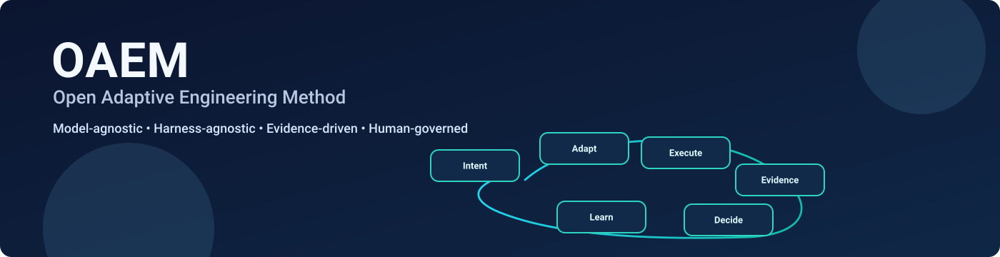
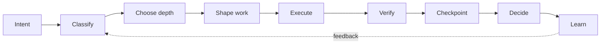

# Open Adaptive Engineering Method (OAEM)



**English** | [Português (Brasil)](README.pt-BR.md)

OAEM is an open, adaptive, model-agnostic, and harness-agnostic methodology for AI-assisted software engineering.

> [!WARNING]
> **Project maturity:** Experimental • Early Foundation • v0.1 development

## Mission

Establish a practical software engineering method that works across:
- different projects and stacks;
- different programming languages;
- different AI models and coding agents;
- different harnesses and operating systems;
- individual and team workflows;
- small fixes through high-risk architecture changes.

## Why OAEM exists

OAEM emerged from long-running practical friction in AI-assisted engineering:
- too much documentation overhead when depth is not adapted to risk;
- composable skills without enough governance for completion/evidence decisions;
- agents stopping one step before implementation;
- false completion claims without deterministic proof;
- confusion about when to continue autonomously vs escalate to humans;
- poor cross-machine reproducibility;
- multi-agent and multi-harness drift;
- long autonomous runs without safe local checkpoints.

Detailed context: [Origin and Motivation](docs/en/origin-and-motivation.md) and [Problems and Failure Modes](docs/en/problems-and-failure-modes.md).

## Core principles

| Principle | Summary |
|---|---|
| Adaptive depth | Use the **minimum sufficient artifact** for real risk and complexity. |
| Evidence over claims | Model confidence is not proof; deterministic checks are authoritative where possible. |
| Human-governed autonomy | Agents execute bounded engineering work and escalate only at real human boundaries. |
| Harness isolation | Common methodology contract + isolated harness adapters; no silent cross-harness mutation. |
| Reproducibility | Fresh-clone conformance is a first-class requirement for method trust. |
| Continuous learning | Method evolves based on observed friction and classified methodology defects. |

## OAEM method loop



Related: [Methodology Overview](docs/en/methodology-overview.md)

## Adaptive depth model (v0.1)

| Level | Name | Typical scope | Minimal flow |
|---|---|---|---|
| 0 | Direct | Local, low-risk, well-understood | intent → implement → focused validation → checkpoint |
| 1 | Ticket | Medium scoped change | goal → acceptance criteria → implementation → focused regression → checkpoint |
| 2 | Temporary Spec | Larger bounded change | temporary spec → vertical stories → implementation loop → evidence → completion → retire spec |
| 3 | Governed Change | Architecture/security/migration/public contract/high-risk | decision artifact → impact analysis → authorized plan → vertical slices → deterministic evidence → human gate |

Related: [Adaptive Depth](docs/en/adaptive-depth.md)

## Pain → OAEM response summary

| Recurring pain | OAEM response |
|---|---|
| Documentation overhead | Risk-calibrated depth instead of one-size-fits-all process |
| Skills without governance | Completion contracts + evidence model + decision boundaries |
| Agents stop early | Explicit execution loops and completion criteria |
| False completion | Deterministic evidence precedence over model claims |
| Human-boundary confusion | Formal distinction: bounded defect vs real boundary |
| Cross-machine failures | Fresh-clone conformance expectations |
| Multi-harness drift | Shared contract + isolated adapters |
| Long autonomous runs | Vertical slices + focused validation + checkpoint cadence |

## Model/harness agnostic architecture

```text
OAEM CORE
  ├─ Skills
  ├─ Templates
  ├─ Contracts
  ├─ Evidence model
  ├─ Completion model
  ├─ Checkpoint policy
  ├─ Human-boundary policy
  ├─ Learning model
  └─ Adapters
      ├─ Generic
      ├─ Ralph
      ├─ Axet
      ├─ Codex
      ├─ Claude
      ├─ Copilot
      ├─ Gemini
      └─ Future harnesses
```

OAEM core is **not** defined by any specific vendor, model, IDE, language, framework, or CI platform.

## Repository structure (v0.1 foundation)

```text
.
├── assets/
├── docs/
│   ├── en/
│   └── pt-BR/
├── methodology/
├── skills/
├── templates/
├── adapters/
│   └── generic/
├── conformance/
└── examples/
```

## Current maturity

- ✅ Foundation documentation created
- ✅ Origin, motivation, and failure modes documented
- ✅ Initial adaptive-depth model defined
- ✅ Governance/security principles drafted
- ⏳ Core contracts and conformance tooling pending

## Roadmap (no dates)

See [ROADMAP.md](ROADMAP.md).

- **0.1** Foundation: principles, motivation, failure modes, adaptive-depth model
- **0.2** Core skills, templates, completion/evidence contracts
- **0.3** Generic + Ralph adapters
- **0.4** Axet/Codex/Claude/Copilot/Gemini adapters
- **0.5** Conformance suite, sample-project validation, cross-harness tests
- **0.6** Real-project adoption case studies
- **1.0** Stable methodology contract

## Inspirations and acknowledgments

OAEM was inspired in part by:
- GitHub Spec Kit
- Matt Pocock’s *Skills for Real Engineers*

OAEM is not a fork, replacement claim, or endorsement by those projects.  
Details: [Inspirations](docs/en/inspirations.md) and [THIRD_PARTY_NOTICES.md](THIRD_PARTY_NOTICES.md).

## Contributing

See [CONTRIBUTING.md](CONTRIBUTING.md).

## Security and governance boundaries

See [SECURITY.md](SECURITY.md).

## License

This repository is distributed under the [MIT License](LICENSE).
