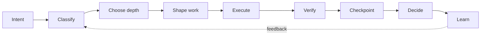

# OAEM

**English** | [Português (Brasil)](README.pt-BR.md)

---

## Experimental Foundation v0.1

OAEM (Open Adaptive Engineering Method) is an open, adaptive, evidence-driven, human-governed software engineering methodology for AI-assisted development.

## For Humans

Understand what OAEM is, why it exists, how to classify changes, select minimum sufficient methodology depth, adopt incrementally, preserve human authority, use autonomous execution safely, and apply checkpoints to reduce risk.

[Get Started for Humans](docs/en/getting-started.md#getting-started-for-humans)

## For AI Agents

Bootstrap OAEM-aware execution with stepwise classification, completion contract satisfaction, fault correction, checkpointing, and escalation for human boundaries.

[Get Started for AI Agents](docs/en/getting-started.md#getting-started-for-ai-agents)

## Core Principles

- Adapt depth to real risk
- Vertical by default (horizontal only by demonstrated necessity)
- Minimum sufficient artifact
- Evidence over claims
- Human authority for consequential decisions
- Fix bounded defects and continue
- Checkpoint coherent progress
- One canonical authority per responsibility
- Harness isolation
- Fresh-clone reproducibility
- Model-agnostic core
- Harness-agnostic core
- Learn from real use
- Opinionated but evidence-humble

## OAEM Method Loop

## Adaptive Depth Overview

OAEM chooses the minimum sufficient engineering artifact and rigor based on risk, scope, and complexity.

## Pain → OAEM Response Summary

OAEM addresses identified practical pains in AI-assisted software engineering such as documentation overhead, false completion claims, unclear human boundaries, cross-machine reproducibility, and others.

## Model/Harness Agnostic Architecture

OAEM core remains independent of specific AI models or agent harnesses, implemented via adapters preserving method invariants.

## Repository Structure

- docs/  
- methodology/  
- skills/  
- templates/  
- adapters/  
- conformance/  
- examples/  
- assets/

## Current Maturity

Experimental v0.1 foundation, shaped by practical use and evidence.

## Roadmap

- Foundation  
- Alpha  
- Beta  
- Release Candidate  
- 1.0 Stable

Versioning reflects demonstrated maturity, not appearance.

## Inspirations and Acknowledgments

OAEM was inspired in part by [GitHub Spec Kit](https://github.com/github/Spec-Kit) and [Skills for Real Engineers](https://github.com/mattpocock/skills).

## Contributing

See [CONTRIBUTING.md](CONTRIBUTING.md).

## License

MIT License — see [LICENSE](LICENSE).
