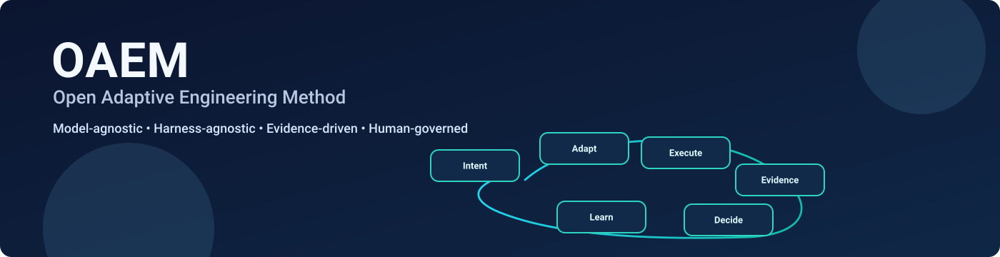
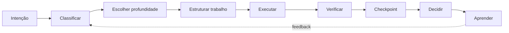

# OAEM

**English** | [Português (Brasil)](README.pt-BR.md)

---

## Fundação Experimental v0.1

OAEM (Open Adaptive Engineering Method) é uma metodologia aberta, adaptativa, orientada por evidências e governada por autoridade humana para engenharia de software assistida por IA.

## Para Pessoas

Entenda o que é OAEM, por que existe, como classificar mudanças, escolher a profundidade mínima suficiente, adotar incrementalmente, preservar autoridade humana, usar execução autônoma com segurança e aplicar checkpoints para redução de riscos.

[Primeiros passos para pessoas](docs/pt-BR/getting-started.md#getting-started-for-humans)

## Para Agentes de IA

Bootstrap para execução consciente da OAEM, com classificação passo a passo, satisfação de contrato de conclusão, correção de falhas, checkpoint e escalonamento para fronteiras humanas.

[Primeiros passos para agentes](docs/pt-BR/getting-started.md#getting-started-for-ai-agents)

## Princípios centrais

- Adaptar profundidade ao risco real
- Vertical por padrão (horizontal apenas por necessidade demonstrada)
- Menor artefato suficiente
- Evidência acima de alegações
- Autoridade humana sobre decisões consequenciais
- Corrigir defeitos delimitados e continuar
- Checkpoint de progresso coerente
- Uma autoridade canônica por responsabilidade
- Isolamento de harness
- Reprodutibilidade em clone limpo
- Núcleo agnóstico de modelo
- Núcleo agnóstico de harness
- Aprender com uso real
- Opiniões fortes com humildade orientada por evidências

## Loop metodológico OAEM

## Visão geral da profundidade adaptativa

OAEM escolhe o menor artefato e rigor de engenharia suficientes baseados em risco, escopo e complexidade.

## Resumo do problema → resposta OAEM

OAEM responde a dores práticas em engenharia assistida por IA, como sobrecarga documental, alegações falsas de conclusão, fronteiras humanas confusas, reprodutibilidade cross-machine, e outras.

## Arquitetura agnóstica a modelo/harness

O núcleo OAEM permanece independente de modelos ou harnesses específicos, implementado via adaptadores que preservam invariantes do método.

## Estrutura do repositório

- docs/  
- methodology/  
- skills/  
- templates/  
- adapters/  
- conformance/  
- examples/  
- assets/

## Maturidade atual

Fundação experimental v0.1, moldada pelo uso prático e evidências.

## Roadmap

- Fundação  
- Alpha  
- Beta  
- Release Candidate  
- 1.0 Estável

Versionamento reflete maturidade demonstrada, não aparência.

## Inspirações e agradecimentos

OAEM foi inspirado, em parte, pelo [GitHub Spec Kit](https://github.com/github/Spec-Kit) e por [Skills for Real Engineers](https://github.com/mattpocock/skills).

## Contribuindo

Veja [CONTRIBUTING.md](CONTRIBUTING.md).

## Licença

Licença MIT — veja [LICENSE](LICENSE).
