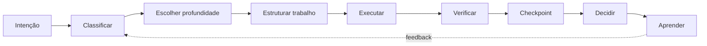

# Open Adaptive Engineering Method (OAEM)


[English](README.md) | **Português (Brasil)**

OAEM é uma metodologia aberta, adaptativa, agnóstica de modelo e agnóstica de harness para engenharia de software assistida por IA.

> [!WARNING]
> **Maturidade do projeto:** Experimental • Fundação inicial • desenvolvimento v0.1

## Missão

Estabelecer um método prático de engenharia de software que funcione em:
- diferentes projetos e stacks;
- diferentes linguagens de programação;
- diferentes modelos de IA e agentes de codificação;
- diferentes harnesses e sistemas operacionais;
- fluxos de trabalho individuais e em equipe;
- desde pequenos ajustes até mudanças arquiteturais de alto risco.

## Por que OAEM existe

OAEM nasceu de fricções reais e recorrentes em trabalhos longos com engenharia assistida por IA:
- excesso de documentação quando a profundidade não é adaptada ao risco;
- Skills composáveis sem governança suficiente para decisões de conclusão/evidência;
- agentes que param um passo antes da implementação;
- alegações de conclusão sem prova determinística;
- confusão entre continuar de forma autônoma vs escalar para humanos;
- baixa reprodutibilidade entre máquinas;
- deriva entre múltiplos agentes e múltiplos harnesses;
- execuções autônomas longas sem checkpoints locais seguros.

Contexto detalhado: [Origem e motivação](docs/pt-BR/origin-and-motivation.md) e [Problemas e modos de falha](docs/pt-BR/problems-and-failure-modes.md).

## Princípios centrais

| Princípio | Resumo |
|---|---|
| Profundidade adaptativa | Usar o **menor artefato suficiente** para o risco e a complexidade reais. |
| Evidência acima de alegação | Confiança de modelo não é prova; verificações determinísticas são autoritativas quando possíveis. |
| Autonomia governada por humanos | Agentes executam trabalho técnico delimitado e escalam somente em fronteiras humanas reais. |
| Isolamento de harness | Contrato metodológico comum + adaptadores isolados; sem mutação silenciosa entre harnesses. |
| Reprodutibilidade | Conformidade de clone limpo é requisito de primeira classe para confiança no método. |
| Aprendizado contínuo | O método evolui com base em fricções observadas e defeitos metodológicos classificados. |

## Loop do método OAEM



Relacionado: [Visão geral da metodologia](docs/pt-BR/methodology-overview.md)

## Modelo de profundidade adaptativa (v0.1)

| Nível | Nome | Escopo típico | Fluxo mínimo |
|---|---|---|---|
| 0 | Direto | Local, baixo risco, bem entendido | intenção → implementar → validação focada → checkpoint |
| 1 | Ticket | Mudança de escopo médio | objetivo → critérios de aceite → implementação → regressão focada → checkpoint |
| 2 | Especificação temporária | Mudança maior, porém delimitada | especificação temporária → histórias verticais → loop de implementação → evidência → conclusão → aposentar especificação |
| 3 | Mudança governada | Arquitetura/segurança/migração/contrato público/alto risco | artefato de decisão → análise de impacto → plano autorizado → fatias verticais → evidência determinística → gate humano |

Relacionado: [Profundidade adaptativa](docs/pt-BR/adaptive-depth.md)

## Resumo dor → resposta OAEM

| Dor recorrente | Resposta OAEM |
|---|---|
| Sobrecarga documental | Profundidade calibrada por risco, em vez de processo único para tudo |
| Skills sem governança | Contratos de conclusão + modelo de evidência + fronteiras de decisão |
| Agentes param cedo | Loops explícitos de execução e critérios de conclusão |
| Conclusão falsa | Precedência de evidência determinística sobre alegações do modelo |
| Confusão de fronteira humana | Distinção formal: defeito técnico delimitado vs fronteira humana real |
| Falhas entre máquinas | Expectativa de conformidade em clone limpo |
| Deriva entre harnesses | Contrato compartilhado + adaptadores isolados |
| Execuções longas sem controle | Fatias verticais + validação focada + cadência de checkpoint |

## Arquitetura agnóstica de modelo/harness

```text
NÚCLEO OAEM
  ├─ Skills
  ├─ Templates
  ├─ Contratos
  ├─ Modelo de evidência
  ├─ Modelo de conclusão
  ├─ Política de checkpoint
  ├─ Política de fronteiras humanas
  ├─ Modelo de aprendizado
  └─ Adaptadores
      ├─ Genérico
      ├─ Ralph
      ├─ Axet
      ├─ Codex
      ├─ Claude
      ├─ Copilot
      ├─ Gemini
      └─ Harnesses futuros
```

O núcleo OAEM **não** é definido por fornecedor, modelo, IDE, linguagem, framework ou plataforma de CI específicos.

## Estrutura do repositório (fundação v0.1)

```text
.
├── assets/
├── docs/
│   ├── en/
│   └── pt-BR/
├── methodology/
├── skills/
├── templates/
├── adapters/
│   └── generic/
├── conformance/
└── examples/
```

## Maturidade atual

- ✅ Documentação de fundação criada
- ✅ Origem, motivação e modos de falha documentados
- ✅ Modelo inicial de profundidade adaptativa definido
- ✅ Princípios de governança/segurança definidos
- ⏳ Contratos centrais e ferramental de conformidade pendentes

## Roadmap (sem datas)

Consulte [ROADMAP.md](ROADMAP.md).

- **0.1** Fundação: princípios, motivação, modos de falha, profundidade adaptativa
- **0.2** Skills centrais, templates, contratos de conclusão/evidência
- **0.3** Adaptadores genérico + Ralph
- **0.4** Adaptadores Axet/Codex/Claude/Copilot/Gemini
- **0.5** Suíte de conformidade, validação em projeto de exemplo, testes cross-harness
- **0.6** Estudos de adoção em projetos reais
- **1.0** Contrato metodológico estável

## Inspirações e agradecimentos

OAEM foi inspirado em parte por:
- GitHub Spec Kit
- *Skills for Real Engineers*, de Matt Pocock

OAEM não é fork, não é reivindicação de substituição e não possui endosso desses projetos.  
Detalhes: [Inspirações](docs/pt-BR/inspirations.md) e [THIRD_PARTY_NOTICES.md](THIRD_PARTY_NOTICES.md).

## Como contribuir

Consulte [CONTRIBUTING.md](CONTRIBUTING.md).

## Segurança e fronteiras de governança

Consulte [SECURITY.md](SECURITY.md).

## Licença

Este repositório é distribuído sob a [Licença MIT](LICENSE).
