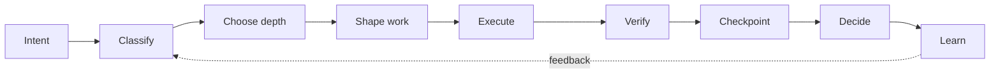

# Methodology Overview

## What OAEM is

OAEM (Open Adaptive Engineering Method) is a software engineering methodology for AI-assisted development.

It is designed to be:
- open;
- adaptive;
- model-agnostic;
- harness-agnostic;
- compatible with individual and team workflows.

OAEM defines **how work should be governed and evidenced**, not which specific model or harness must be used.

## What OAEM is not

OAEM is not:
- a prompt collection;
- a standalone Skill collection;
- an AI coding framework;
- an agent;
- a harness;
- a CI system;
- a vendor-bound stack.

## Core conceptual loop



### Loop step intent

| Step | Purpose |
|---|---|
| Intent | Establish the engineering objective and expected outcome. |
| Classify | Assess risk, complexity, uncertainty, and scope. |
| Choose depth | Select the minimum sufficient artifact level. |
| Shape work | Decompose into bounded, reviewable slices. |
| Execute | Implement and correct within allowed autonomous scope. |
| Verify | Produce deterministic evidence whenever possible. |
| Checkpoint | Record a local known-good state and evidence linkage. |
| Decide | Continue, escalate, or close based on evidence and policy. |
| Learn | Capture methodology/harness friction for iterative improvement. |

## Method architecture

```text
OAEM CORE
  ├─ Skills
  ├─ Templates
  ├─ Contracts
  ├─ Evidence model
  ├─ Completion model
  ├─ Checkpoint policy
  ├─ Human-boundary policy
  ├─ Learning model
  └─ Adapters
      ├─ Generic
      ├─ Ralph
      ├─ Axet
      ├─ Codex
      ├─ Claude
      ├─ Copilot
      ├─ Gemini
      └─ Future harnesses
```

OAEM core is independent from any specific model vendor or harness runtime.

## Foundational principles

1. **Adaptive depth over uniform process**
2. **Deterministic evidence over model confidence**
3. **Bounded autonomy with explicit human boundaries**
4. **Harness portability through contract + adapter separation**
5. **Cross-machine reproducibility as a method quality signal**
6. **Continuous methodology improvement from observed friction**

## Related specifications (v0.1 docs)

- [Adaptive Depth](adaptive-depth.md)
- [Completion Contract](completion-contract.md)
- [Evidence Model](evidence-model.md)
- [Checkpoint Policy](checkpoint-policy.md)
- [Human Boundaries](human-boundaries.md)
- [Harness Portability](harness-portability.md)
- [Continuous Learning](continuous-learning.md)
