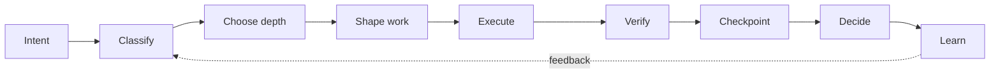

# OAEM Methodology (Canonical)

## Scope

This document is the canonical methodology authority for OAEM Foundation v0.1.

It consolidates method intent, principles, operating loop, adaptive depth, completion and evidence expectations, human boundaries, checkpoint discipline, harness portability invariants, and continuous learning.

## What OAEM is

OAEM (Open Adaptive Engineering Method) is an open, adaptive, evidence-driven, human-governed software engineering methodology for AI-assisted development.

It is:
- model-agnostic;
- AI-provider-agnostic;
- harness-agnostic;
- applicable to individual and team workflows.

## What OAEM is not

OAEM is not:
- a prompt library;
- a single Skill;
- a coding agent;
- a harness;
- a wrapper for a specific agent ecosystem;
- a fork/replacement claim of another methodology;
- a framework tied to one model, provider, language, IDE, or stack.

## Why OAEM exists

OAEM emerged from recurring practical friction in long-running AI-assisted engineering:

- documentation overhead without adaptive depth;
- Skills without enough governance structure;
- agents stopping one step before implementation;
- false completion claims without current deterministic evidence;
- confusion between bounded defects and true human decision boundaries;
- cross-machine reproducibility failures;
- multi-agent/multi-harness drift;
- long autonomous runs without coherent checkpoints.

## Core conceptual loop

## Foundational principles

1. **Adapt depth to real risk**
2. **Vertical by default (horizontal only by demonstrated necessity)**
3. **Minimum sufficient artifact**
4. **Evidence over claims**
5. **Human authority for consequential decisions**
6. **Fix bounded defects and continue**
7. **Checkpoint coherent progress**
8. **One canonical authority per responsibility**
9. **Harness isolation**
10. **Fresh-clone reproducibility**
11. **Model-agnostic core**
12. **Harness-agnostic core**
13. **Learn from real use**
14. **Opinionated but evidence-humble**

OAEM should be opinionated enough to be useful, but humble enough to change when evidence contradicts it.

## Vertical by default

Canonical rule:

**VERTICAL BY DEFAULT.  
HORIZONTAL ONLY BY DEMONSTRATED NECESSITY.**

Preferred flow for changes:

`intent → contract → minimum required implementation → focused test → integration → evidence → checkpoint → done`

Preferred flow for defects:

`observed failure → reproduce → first broken contract → smallest sound correction → regression test → affected regression → evidence → checkpoint`

Horizontal work is legitimate only with explicit:
- why;
- scope boundary;
- exit criteria;
- vertical outcomes enabled or protected.

## Adaptive depth (v0.1)

### Level 0 — Direct
For small, local, low-risk, well-understood work.

Flow:
`intent → implementation → focused evidence → checkpoint`

### Level 1 — Ticket
For medium scoped work.

Flow:
`goal → acceptance criteria → vertical implementation → focused regression → checkpoint`

### Level 2 — Temporary Spec
For larger bounded changes.

Flow:
`temporary spec → vertical stories → implementation loops → evidence → completion → archive/retire temporary spec`

### Level 3 — Governed Change
For architecture/security/migration/data-model/public-contract/high-impact behavior.

Flow:
`decision artifact → impact/risk analysis → authorized plan → vertical slices → deterministic evidence → human gate`

Canonical rule:
**Use the minimum sufficient engineering artifact for the real risk.**

## Completion and evidence

“Done” is a contract, not an agent statement.

Where deterministic verification exists, deterministic evidence is authoritative.

Model confidence does not replace execution evidence.

Foundation-level completion states:
- `IMPLEMENTED`
- `VALIDATED`
- `HUMAN_REVIEW_REQUIRED`
- `BLOCKED`
- `DEFERRED`
- `PARTIAL`

Evidence classes at foundation level:
- execution evidence;
- test/build/static-analysis evidence (project-defined applicability);
- security evidence where required;
- documentation consistency evidence;
- fresh-clone evidence;
- human decision records;
- model review/inference (non-authoritative when deterministic checks exist).

## Human boundaries

Bounded engineering defects should be fixed and execution should continue.

Real human boundaries include:
- new dependencies;
- credentials/secret handling;
- external access enablement;
- security-policy weakening;
- major architectural replacement beyond approved scope;
- destructive operations;
- release/publish/deploy;
- business/product/legal/compliance decisions.

## Checkpoint policy

Long autonomous work should proceed as:

`vertical slice → focused validation → local checkpoint → continue`

Checkpoint, push, and release are separate authority boundaries.

## Harness portability and isolation

OAEM core governs method, not provider/runtime specifics.

Adapters may own harness-specific details (executor, tools, permissions, hooks, timeouts, parsing, completion signaling), but must preserve OAEM invariants.

Critical invariant:
**One harness must not silently mutate another harness configuration.**

## Fresh-clone reproducibility

A committed project state should be sufficient for an authorized fresh environment to reconstruct expected workflow behavior.

## Continuous learning

Feedback loop:

`use OAEM → observe friction → reproduce → classify → improve → add conformance/regression evidence → release improved methodology`

Typical categories:
- `METHOD_DEFECT`
- `SKILL_DEFECT`
- `ADAPTER_DEFECT`
- `HARNESS_DEFECT`
- `DOCUMENTATION_DEFECT`
- `FALSE_COMPLETION`
- `FALSE_HUMAN_BOUNDARY`
- `MISSING_EVIDENCE`
- `UNNECESSARY_ARTIFACT`
- `CONTEXT_OVERHEAD`
- `CROSS_MACHINE_FAILURE`
- `AGENT_SCOPE_DRIFT`
- `VALIDATION_GAP`
