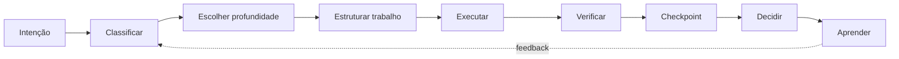

# Visão geral da metodologia

## O que é OAEM

OAEM (Open Adaptive Engineering Method) é uma metodologia de engenharia de software para desenvolvimento assistido por IA.

Ela foi concebida para ser:
- aberta;
- adaptativa;
- agnóstica de modelo;
- agnóstica de harness;
- compatível com fluxos individuais e em equipe.

OAEM define **como o trabalho deve ser governado e evidenciado**, e não qual modelo ou harness deve ser usado.

## O que OAEM não é

OAEM não é:
- coleção de prompts;
- coleção isolada de Skills;
- framework de codificação com IA;
- agente;
- harness;
- sistema de CI;
- stack presa a fornecedor.

## Loop conceitual central



### Intenção de cada etapa

| Etapa | Propósito |
|---|---|
| Intenção | Definir objetivo de engenharia e resultado esperado. |
| Classificar | Avaliar risco, complexidade, incerteza e escopo. |
| Escolher profundidade | Selecionar o menor nível de artefato suficiente. |
| Estruturar trabalho | Decompor em fatias delimitadas e revisáveis. |
| Executar | Implementar e corrigir dentro do escopo autônomo permitido. |
| Verificar | Produzir evidência determinística quando possível. |
| Checkpoint | Registrar estado local válido com vínculo de evidência. |
| Decidir | Continuar, escalar ou encerrar com base em evidência e política. |
| Aprender | Capturar fricções de método/harness para melhoria iterativa. |

## Vertical por padrão

**VERTICAL BY DEFAULT** é princípio de primeira classe no OAEM.

O trabalho deve ser fatiado por resultados completos, e não por camadas técnicas isoladas.

Uma fatia vertical cruza as camadas necessárias para produzir resultado verificável de forma independente:
- valor;
- comportamento;
- evidência;
- redução de risco;
- aprendizado.

Fluxo preferido:
`intenção → contrato → implementação mínima nas camadas necessárias → validação focada → integração → evidência → checkpoint → concluído`

Evitar execução horizontal por padrão, como:
`todos os modelos → todos os repositórios → todas as APIs → todos os testes → documentação depois`

porque isso tende a aumentar:
- trabalho em progresso;
- carga de contexto;
- deriva de escopo;
- raio de regressão;
- tempo sem resultado concluído.

### Defeitos também são verticais

Correção de bug também segue fatia vertical:

`falha observada → reproduzir → primeiro contrato quebrado → menor correção tecnicamente sólida → teste de regressão → regressão afetada → evidência → checkpoint`

Evitar padrão:
“já que estou nesta camada, vou refatorar a camada inteira”.

### Exceção horizontal

OAEM não afirma que trabalho horizontal é sempre errado.

Regra canônica:
- **Vertical por padrão**
- **Horizontal apenas por necessidade demonstrada**

Exemplos legítimos de trabalho horizontal:
- migrações de segurança;
- migrações de schema compartilhado;
- upgrades de runtime;
- reforço de políticas;
- compatibilidade transversal;
- infraestrutura que desbloqueia/protege resultados verticais identificáveis.

Quando horizontal for necessário, exigir:
- justificativa explícita;
- escopo delimitado;
- critérios de saída;
- resultados verticais que serão habilitados/protegidos.

## Arquitetura do método

```text
NÚCLEO OAEM
  ├─ Skills
  ├─ Templates
  ├─ Contratos
  ├─ Modelo de evidência
  ├─ Modelo de conclusão
  ├─ Política de checkpoint
  ├─ Política de fronteiras humanas
  ├─ Modelo de aprendizado
  └─ Adaptadores
      ├─ Genérico
      ├─ Ralph
      ├─ Axet
      ├─ Codex
      ├─ Claude
      ├─ Copilot
      ├─ Gemini
      └─ Harnesses futuros
```

O núcleo OAEM é independente de fornecedor de modelo ou runtime de harness específico.

## Princípios de fundação

1. **Adaptar profundidade ao risco**
2. **Vertical por padrão**
3. **Evidência acima de alegações**
4. **Autoridade humana sobre decisões consequenciais**
5. **Corrigir defeitos delimitados e continuar**
6. **Checkpoint de progresso coerente**
7. **Uma autoridade canônica por responsabilidade**
8. **Isolamento de harness**
9. **Reprodutibilidade em clone limpo**
10. **Núcleo agnóstico de modelo e harness**
11. **Aprender com uso real**
12. **Menor artefato suficiente**

## Especificações relacionadas (docs v0.1)

- [Profundidade adaptativa](adaptive-depth.md)
- [Contrato de conclusão](completion-contract.md)
- [Modelo de evidência](evidence-model.md)
- [Política de checkpoint](checkpoint-policy.md)
- [Fronteiras humanas](human-boundaries.md)
- [Portabilidade entre harnesses](harness-portability.md)
- [Aprendizado contínuo](continuous-learning.md)
