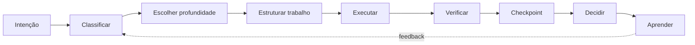

# Metodologia OAEM (Canônica)

## Escopo

Este documento é a autoridade metodológica canônica da OAEM Foundation v0.1.

Ele consolida intenção do método, princípios, loop operacional, profundidade adaptativa, expectativas de conclusão e evidência, fronteiras humanas, disciplina de checkpoint, invariantes de portabilidade entre harnesses e aprendizado contínuo.

## O que é OAEM

OAEM (Open Adaptive Engineering Method) é uma metodologia aberta, adaptativa, orientada por evidências e governada por autoridade humana para engenharia de software assistida por IA.

Ela é:
- agnóstica de modelo;
- agnóstica de provedor de IA;
- agnóstica de harness;
- aplicável a fluxos individuais e em equipe.

## O que OAEM não é

OAEM não é:
- biblioteca de prompts;
- Skill única;
- agente de codificação;
- harness;
- wrapper de um ecossistema específico de agente;
- fork/alegação de substituição de outra metodologia;
- framework preso a um único modelo, provedor, linguagem, IDE ou stack.

## Por que OAEM existe

A OAEM surgiu de fricções práticas recorrentes em engenharia assistida por IA de longa duração:

- sobrecarga documental sem profundidade adaptativa;
- uso de Skills sem governança suficiente;
- agentes parando um passo antes da implementação;
- alegações de conclusão sem evidência determinística atual;
- confusão entre defeito delimitado e fronteira real de decisão humana;
- falhas de reprodutibilidade entre máquinas;
- deriva entre múltiplos agentes e múltiplos harnesses;
- execuções autônomas longas sem checkpoints coerentes.

## Loop conceitual central

## Princípios de fundação

1. **Adaptar profundidade ao risco real**
2. **Vertical por padrão (horizontal apenas por necessidade demonstrada)**
3. **Menor artefato suficiente**
4. **Evidência acima de alegações**
5. **Autoridade humana sobre decisões consequenciais**
6. **Corrigir defeitos delimitados e continuar**
7. **Checkpoint de progresso coerente**
8. **Uma autoridade canônica por responsabilidade**
9. **Isolamento de harness**
10. **Reprodutibilidade em clone limpo**
11. **Núcleo agnóstico de modelo**
12. **Núcleo agnóstico de harness**
13. **Aprender com uso real**
14. **Opiniões fortes com humildade orientada por evidências**

A OAEM deve ter opiniões fortes o suficiente para ser útil, mas humildade suficiente para mudar quando as evidências demonstrarem que está errada.

## Vertical por padrão

Regra canônica:

**VERTICAL POR PADRÃO.  
HORIZONTAL APENAS POR NECESSIDADE DEMONSTRADA.**

Fluxo preferido para mudanças:

`intenção → contrato → implementação mínima necessária → teste focado → integração → evidência → checkpoint → concluído`

Fluxo preferido para defeitos:

`falha observada → reproduzir → primeiro contrato quebrado → menor correção tecnicamente sólida → teste de regressão → regressão afetada → evidência → checkpoint`

Trabalho horizontal só é legítimo com explicitação de:
- por que;
- fronteira de escopo;
- critérios de saída;
- resultados verticais habilitados ou protegidos.

## Profundidade adaptativa (v0.1)

### Nível 0 — Direto
Para trabalho pequeno, local, de baixo risco e bem compreendido.

Fluxo:
`intenção → implementação → evidência focada → checkpoint`

### Nível 1 — Ticket
Para trabalho de escopo médio.

Fluxo:
`objetivo → critérios de aceite → implementação vertical → regressão focada → checkpoint`

### Nível 2 — Especificação Temporária
Para mudanças maiores, porém delimitadas.

Fluxo:
`especificação temporária → histórias verticais → loops de implementação → evidência → conclusão → arquivar/aposentar especificação temporária`

### Nível 3 — Mudança Governada
Para arquitetura/segurança/migração/modelo de dados/contrato público/comportamento de alto impacto.

Fluxo:
`artefato de decisão → análise de impacto/risco → plano autorizado → fatias verticais → evidência determinística → gate humano`

Regra canônica:
**Usar o menor artefato de engenharia suficiente para o risco real.**

## Conclusão e evidência

“Concluído” é contrato, não declaração do agente.

Onde há verificação determinística, evidência determinística é autoritativa.

Confiança do modelo não substitui evidência de execução.

Estados de conclusão em nível de fundação:
- `IMPLEMENTED`
- `VALIDATED`
- `HUMAN_REVIEW_REQUIRED`
- `BLOCKED`
- `DEFERRED`
- `PARTIAL`

Classes de evidência em nível de fundação:
- evidência de execução;
- evidência de testes/build/análise estática (conforme aplicabilidade do projeto);
- evidência de segurança quando exigida;
- evidência de consistência documental;
- evidência de clone limpo;
- registro de decisão humana;
- revisão/inferência de modelo (não autoritativa quando há checagem determinística).

## Fronteiras humanas

Defeitos técnicos delimitados devem ser corrigidos e a execução deve continuar.

Fronteiras humanas reais incluem:
- novas dependências;
- credenciais/segredos;
- habilitação de acesso externo;
- enfraquecimento de política de segurança;
- substituição arquitetural ampla fora do escopo aprovado;
- operações destrutivas;
- release/publicação/deploy;
- decisões de negócio/produto/jurídico/compliance.

## Política de checkpoint

Trabalho autônomo longo deve seguir:

`fatia vertical → validação focada → checkpoint local → continuar`

Checkpoint, push e release são fronteiras de autoridade distintas.

## Portabilidade e isolamento entre harnesses

O núcleo OAEM governa o método, não detalhes de provedor/runtime.

Adaptadores podem ter detalhes específicos de harness (executor, ferramentas, permissões, hooks, timeouts, parsing, sinalização de conclusão), mas devem preservar invariantes da OAEM.

Invariante crítica:
**Um harness não deve mutar silenciosamente a configuração de outro harness.**

## Reprodutibilidade em clone limpo

O estado commitado de um projeto deve ser suficiente para um ambiente novo autorizado reconstruir o comportamento esperado de workflow.

## Aprendizado contínuo

Loop de feedback:

`usar OAEM → observar fricção → reproduzir → classificar → melhorar → adicionar evidência de conformidade/regressão → publicar metodologia aprimorada`

Categorias típicas:
- `METHOD_DEFECT`
- `SKILL_DEFECT`
- `ADAPTER_DEFECT`
- `HARNESS_DEFECT`
- `DOCUMENTATION_DEFECT`
- `FALSE_COMPLETION`
- `FALSE_HUMAN_BOUNDARY`
- `MISSING_EVIDENCE`
- `UNNECESSARY_ARTIFACT`
- `CONTEXT_OVERHEAD`
- `CROSS_MACHINE_FAILURE`
- `AGENT_SCOPE_DRIFT`
- `VALIDATION_GAP`
